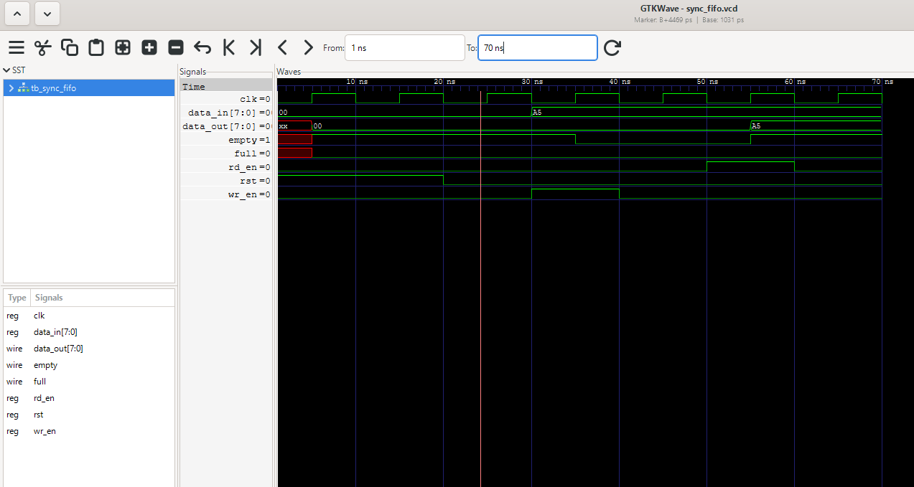

# Synchronous FIFO Design Using Verilog HDL

A synchronous First-In, First-Out (FIFO) design implemented using Verilog HDL. This project demonstrates fundamental RTL design concepts, including sequential logic, memory management, pointer control, status flag generation, and functional verification.

The project is developed as part of my journey toward becoming an RTL Design / ASIC Design Engineer.

## Project Status

🚧 **In Progress**

- Basic FIFO RTL implementation completed.
- Single write and read simulation successfully verified.
- Extended verification and corner-case testing are in progress.

## 1. Overview

A FIFO (First-In, First-Out) is a memory structure in which the first data written is the first data read.

A synchronous FIFO performs read and write operations using a common clock signal. It is commonly used in digital systems for temporary data storage, buffering, and communication between hardware modules.

The objective of this project is to design a synchronous FIFO using Verilog HDL and verify its functionality through simulation.

## 2. Design Specifications

| Parameter | Specification |
|---|---|
| Design | Synchronous FIFO |
| HDL | Verilog |
| Data Width | 8 bits |
| FIFO Depth | 16 entries |
| Storage Capacity | 128 bits |
| Clock | Single clock |
| Reset | Synchronous, active-high |
| Read Operation | Clock-synchronized |
| Write Operation | Clock-synchronized |
| Simulation | Icarus Verilog |
| Waveform Viewer | GTKWave |

## 3. FIFO Architecture

The FIFO consists of the following main components:

- **Memory Array:** Stores the input data.
- **Write Pointer:** Tracks the location where the next data will be written.
- **Read Pointer:** Tracks the location from which the next data will be read.
- **Occupancy Counter:** Tracks the number of stored entries.
- **Full Flag:** Indicates when all 16 FIFO entries are occupied.
- **Empty Flag:** Indicates when the FIFO contains no data.

### Block Diagram


## 4. Key Features

- 8-bit data storage.
- 16-entry FIFO memory.
- Independent read and write pointers.
- Synchronous reset functionality.
- Full and empty flag generation.
- Occupancy tracking using a counter.
- FIFO data ordering.
- Pointer wraparound through 4-bit pointer arithmetic.

## 5. Repository Structure

```text
Synchronous FIFO Design/
│
├── rtl/
│   └── sync_fifo.v
│
├── tb/
│   └── tb_sync_fifo.v
│
├── sim/
│   └── test1.png
│
└── README.md
```

## 6. Simulation and Verification

The design is simulated using **Icarus Verilog**. GTKWave is used to inspect signal transitions and verify the behavior of the FIFO.

### Test 1 — Single Write and Read

**Test Objective:** Verify that data written into the FIFO can be read back correctly.

Test sequence:

1. Apply synchronous reset.
2. Write `8'hA5` into the FIFO.
3. Disable the write operation.
4. Enable the read operation.
5. Check the output data.
6. Verify the empty flag after the read.

**Expected Output:** `8'hA5`

**Simulation Result:** PASS

- Data was written successfully.
- The expected data was received during the read operation.
- The FIFO empty flag was asserted after the read.

### Test 1 — Simulation Waveform



### Verification Progress

| Test Case | Status |
|---|---|
| Synchronous reset | Completed |
| Single write operation | PASS |
| Single read operation | PASS |
| Output data verification | PASS |
| Empty flag verification | PASS |
| Multiple write/read operations | Pending |
| FIFO ordering | Pending |
| Full FIFO condition | Pending |
| Write while full | Pending |
| Read while empty | Pending |
| Simultaneous read/write | Pending |
| Pointer wraparound | Pending |
| Reset during operation | Pending |

## 7. Running the Simulation

### Prerequisites

- Icarus Verilog
- GTKWave (optional, for waveform visualization)

### Compile the RTL and Testbench

Open the terminal in the project directory and run:

```bash
iverilog -g2012 -o fifo_sim rtl/sync_fifo.v tb/tb_sync_fifo.v
```

### Run the Simulation

```bash
vvp fifo_sim
```

### View the Waveform

If waveform dumping is enabled in the testbench:

```bash
gtkwave sync_fifo.vcd
```

## 8. Tools and Technologies

| Tool | Purpose |
|---|---|
| Verilog HDL | RTL design |
| Icarus Verilog | Compilation and simulation |
| GTKWave | Waveform analysis |
| Visual Studio Code | Code development |
| Git | Version control |
| GitHub | Project hosting and documentation |

## 9. Development Roadmap

- [x] Define FIFO architecture and specifications
- [x] Implement memory array
- [x] Implement write pointer and write logic
- [x] Implement read pointer and read logic
- [x] Implement full and empty flags
- [x] Implement occupancy counter
- [x] Develop basic testbench
- [x] Verify single write and read operation
- [ ] Verify multiple data transactions
- [ ] Test FIFO full and empty conditions
- [ ] Verify simultaneous read and write
- [ ] Test pointer wraparound
- [ ] Perform corner-case verification
- [ ] Inspect and document additional waveforms
- [ ] Perform synthesis checks

## 10. Learning Outcomes

This project helps develop practical understanding of:

- RTL design using Verilog HDL.
- Combinational and sequential logic.
- Clocked processes and non-blocking assignments.
- Memory arrays and pointer arithmetic.
- FIFO architecture and control logic.
- Status flag generation.
- Testbench development.
- Simulation-based functional verification.
- Debugging using waveform analysis.

## 11. Future Improvements

- Develop a more comprehensive self-checking testbench.
- Add a scoreboard for automated data-order verification.
- Verify all FIFO boundary conditions.
- Explore parameterized FIFO architecture.
- Perform synthesis and inspect hardware resource utilization.

## 12. Author

**Sanmugappriyan S**

Electronics and Communication Engineering

GitHub: [ssanmugappriyan](https://github.com/ssanmugappriyan/Sanmugappriyan)

---

*This project is part of my continuous learning in RTL design, digital systems, and ASIC design. Further implementation and verification results will be documented as development progresses.*
